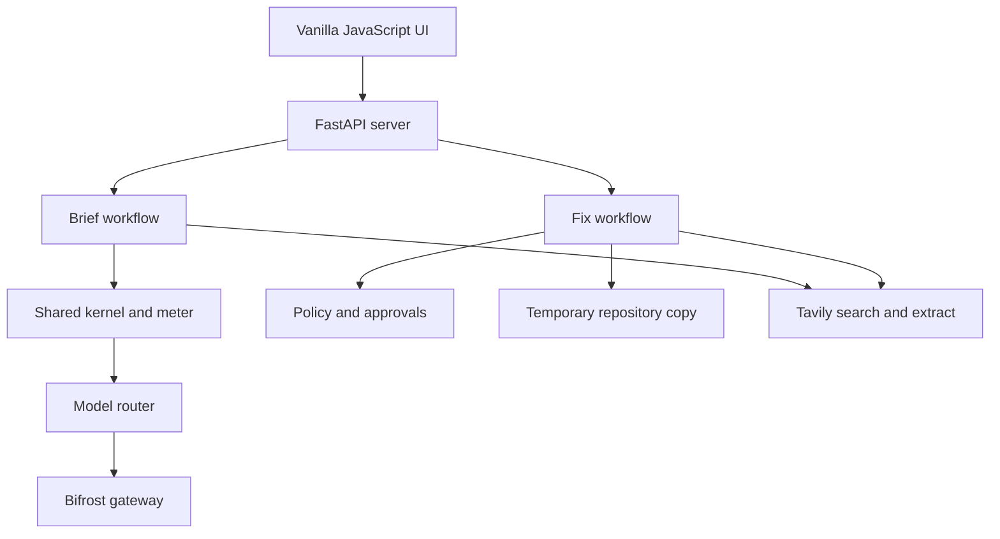

# Ledger Agent Kernel

Ledger is a local-first application for evidence-backed Brief research and policy-gated repository fixes. It makes model use, source checks, token metering, approvals, and run events visible through a FastAPI service and a vanilla JavaScript interface.

## What it is

The application has primary workflows:

- **Brief** gathers sources, checks claims against retrieved evidence, and exposes the checks and excerpts in the interface.
- **Fix** copies an allowed repository into a sandbox, localizes test failures, and proposes edits. Running tests, applying the final diff, and committing require separate policy approvals.

The policy engine, rather than model output or repository content, decides whether an action is allowed, needs approval, or is denied. Confidential repositories are classified in code and routed only to configured local providers.

## Status

| Capability | Status | Notes |
|---|---|---|
| Offline Brief and claim-evidence interface | Done | Supports local replay and source previews. Live retrieval requires service configuration. |
| Sandboxed Fix and approval flow | Done | Changes are prepared in a sandbox; real-repository writes require approval. |
| Confidential local-only routing | Done | Enforced by application code; prompt and repository text cannot lower protection. |
| Red-team runner and interface | Done | Scenarios execute through the local application paths and report their evidence. |
| Benchmark runner and summarizer | Done | Produces run records and a summary when invoked. |
| Bifrost and Tavily live connectivity | Not verified live | Requires configured endpoints and credentials; live service behavior has not been validated here. |
| Recorded benchmark results | Not done | No benchmark summary is present in `bench/results/summary.json`. |
| Green full test suite | Not done | Existing tests include Fix requests using a previous API contract. |
| GitHub Actions workflow | Done | Configured to run the test suite on pushes; remote execution has not been observed. |

No live integration is marked verified live. The status above distinguishes implemented paths from externally validated service behavior.

## Architecture



The browser consumes run events from the server. Brief and Fix share metering and routing, while policy decisions and approvals guard actions that can change files or reach external services.

## Windows quickstart

Use PowerShell from the repository directory:

```powershell
py -m venv .venv
.\.venv\Scripts\python.exe -m pip install -r requirements.txt
.\.venv\Scripts\python.exe -m uvicorn server:app --reload
```

Open the localhost address printed by Uvicorn. Without service credentials, use the offline paths for a local walkthrough. Keep the server process open while using the page.

## Environment variables

Unset variables use the defaults documented by the code where applicable. Secret values must be supplied through the process environment and must not be committed.

| Variable | Purpose |
|---|---|
| `BIFROST_URL` | Base URL for the configured Bifrost gateway. |
| `BIFROST_VK` | General Bifrost virtual key when a user-specific key is not configured. |
| `LEDGER_VK_<USER>` | Optional virtual key selected for a user. |
| `LEDGER_CHEAP`, `LEDGER_STRONG` | Default model identifiers for the cheap and strong tiers. |
| `LEDGER_CHAIN_CHEAP`, `LEDGER_CHAIN_STRONG` | Ordered model chains for the corresponding tiers. |
| `BIFROST_VK_LOCAL` | Virtual key used for confidential local-model requests. |
| `LEDGER_LOCAL_CHAIN` | Ordered model chain used for confidential requests. |
| `LOCAL_PROVIDERS` | Provider allowlist used by the confidential egress guard. |
| `TAVILY_API_KEY` | Credential for Tavily search and extraction. |
| `LEDGER_ALLOWED_ROOTS` | Path-separated roots within which Fix may accept repositories. |
| `LEDGER_USER_CAP` | Positive per-user token cap. |
| `LEDGER_BUDGET_FILE` | Optional path for the persisted per-user budget ledger. `LEDGER_USAGE_FILE` remains a compatibility fallback. |
| `LEDGER_OFFLINE_STUB` | Enables the explicitly labeled offline patch stub for the toy task. |
| `LEDGER_DEMO` | Enables demo-only routing and chaos hooks. |
| `LEDGER_MODEL_CHEAP` | Model identifier used by the standalone service smoke check. |

On Windows, path-separated root values use the platform path separator. Configure confidential routing with local providers and a local key; a cloud provider is rejected by the egress guard.

## Bifrost and Tavily call sites

- Model requests flow through `kernel.chat()` into `router.complete()` in [router.py](router.py). The router sends the chat-completion request to `BIFROST_URL`; it selects configured model chains, attaches the applicable virtual key, records usage, and blocks non-local providers for confidential runs.
- Brief's live source collection calls `kernel.tavily_news()` and `kernel.tavily_extract()` from [modes.py](modes.py). These functions in [kernel.py](kernel.py) send search and extraction requests to Tavily. Confidential Brief runs do not use Tavily.
- For eligible non-confidential API-style Fix errors, [fixer.py](fixer.py) can request API documentation through the same Tavily search and extraction helpers. The query and network action are policy-gated.
- [smoke.py](smoke.py) is a separate manual connectivity check for configured Bifrost and Tavily services; it is not required for offline use.

Provider documentation and source links are collected in [docs/LINKS.md](docs/LINKS.md). The implementation's actual request behavior is defined by the code paths above.

## Reproducing the benchmark

Benchmark tasks are declared under `bench/tasks/`. Run the configured benchmark arms, then summarize the recorded trials:

```powershell
python -m bench run
python -m bench summarize
```

The runner appends trial records to `bench/results/runs.jsonl`; summarization writes `bench/results/summary.json`. The benchmark endpoint and interface read that generated summary. No outcome, cost, or confidence interval should be quoted until the file exists and has been inspected.

## AI-tool disclosure

Claude and GitHub Copilot were used as development aids. Generated code and documentation require maintainer review; tool output is not treated as authorization or evidence.

## Limitations

- Live Bifrost and Tavily behavior depends on external configuration and has not been verified in this workspace.
- The repository has no recorded benchmark summary, so comparative benchmark outcomes are unavailable.
- The full existing test suite is not green because some legacy tests use the previous Fix request contract.
- The offline patch stub is limited to the toy benchmark task and is not a substitute for a configured model.
- Retrieved web text, repository files, and model output are untrusted inputs; the system still depends on correct policy configuration and human approval for gated actions.
